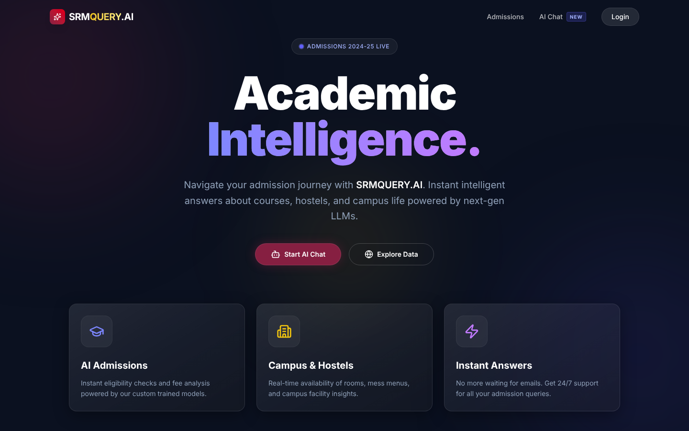
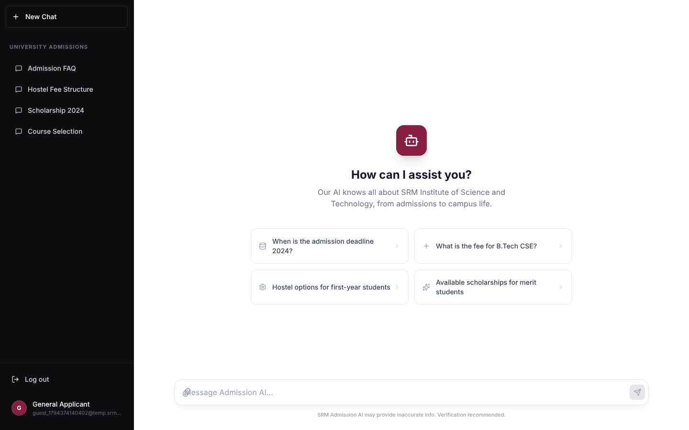
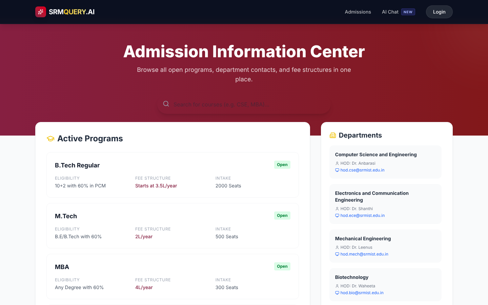
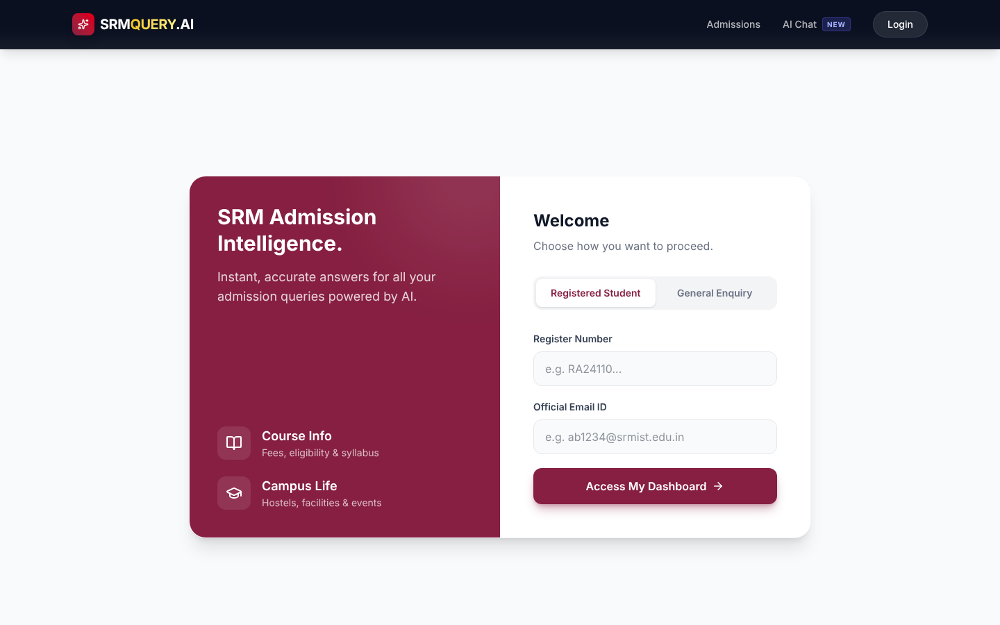
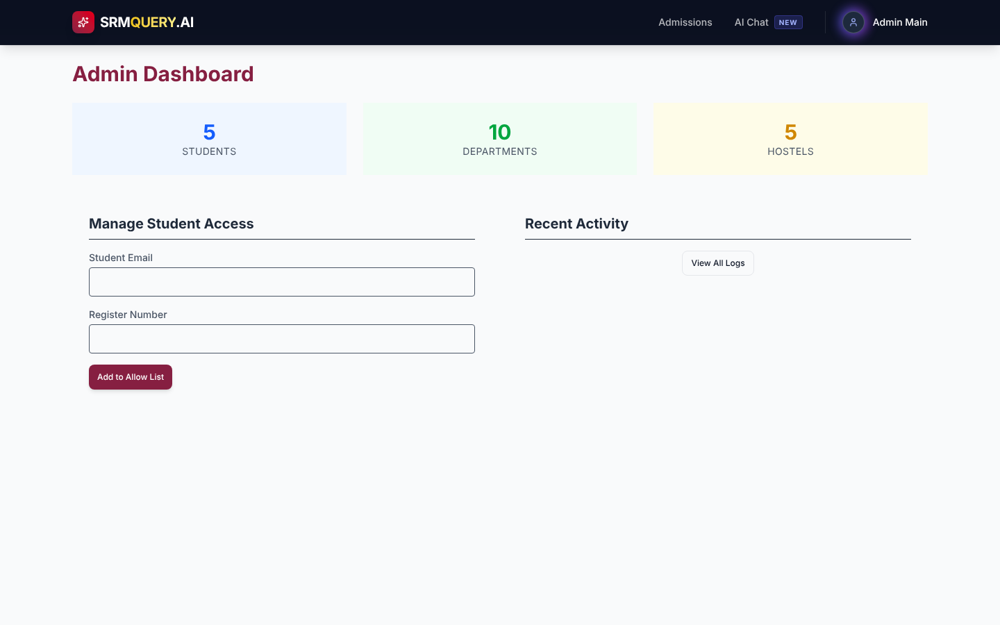

# SRM Query.AI — University Admission Query Chatbot

A full-stack admission helpdesk for SRM Institute of Science and Technology. Applicants and students ask questions about courses, fees and hostels in a chat interface, and the answers are grounded in live data from a MySQL database and generated by a local LLM running on Ollama.

> Academic project. Not an official SRMIST product.



## Features

- **AI chat assistant** — pulls matching course, fee and hostel rows from MySQL, passes them to a local Ollama model as context, and returns the answer.
- **Offline fallback** — if Ollama is not running, the bot still answers from the database records instead of failing.
- **Three access levels**
  - *General enquiry*: one-click guest access for applicants.
  - *Registered student*: sign in with register number and official email (only allow-listed students can register).
  - *Admin console*: stats, recent activity, and management of the student allow-list.
- **Admission Information Center** — open programmes with eligibility, fees and intake, plus department contacts.
- **Login logging** — every sign-in is recorded in MySQL.
- **JWT-protected API** with role checks, and bcrypt-hashed passwords.

## Screenshots

| Chat | Admission Information Center |
|---|---|
|  |  |

| Login | Admin dashboard |
|---|---|
|  |  |

## Tech stack

| Layer | Tools |
|---|---|
| Frontend | Next.js 16 (App Router), React 19, TypeScript, Tailwind CSS 4, Framer Motion |
| Backend | Node.js, Express 4, JWT, bcrypt |
| Database | MySQL (views, a trigger and a stored function included) |
| AI | Ollama running `llama3` locally |

## Project structure

```text
backend/
  server.js            Express app and route mounting
  config/db.js         MySQL connection pool
  controllers/         auth, chat, admin, student, general
  middleware/          JWT verification and role checks
  routes/              /api/auth, /api/chat, /api/admin, /api/student, /api/general
  .env.example         Environment template
frontend/
  src/app/             Pages: landing, login, register, chat, dashboards, admin login
  src/components/      Navbar and UI components
  src/context/         Auth context
schema.sql             Database schema and seed data used by the app
improved_schema.sql    Alternative normalised schema design (not used by the backend)
demo_queries.sql       Sample queries: aggregates, joins, subquery, views, trigger, function
Start_SRM_AI.bat       Windows launcher for Ollama, backend and frontend
```

## Getting started

### Prerequisites

- Node.js 20 or later
- MySQL 8
- [Ollama](https://ollama.com) with the `llama3` model (optional; the bot falls back to database answers without it)

### 1. Database

```bash
mysql -u root -p < schema.sql
```

This creates the `university_admission_db` database with sample data.

### 2. Backend

```bash
cd backend
cp .env.example .env      # then edit .env with your own values
npm install
npm start                 # http://localhost:5000
```

Set `ADMIN_USERNAME` and `ADMIN_KEY` in `.env` to enable the admin console login.

### 3. Frontend

```bash
cd frontend
npm install
npm run dev               # http://localhost:3000
```

### 4. AI model (optional)

```bash
ollama pull llama3
ollama serve
```

On Windows, `Start_SRM_AI.bat` starts Ollama, the backend and the frontend together.

## API overview

| Method | Endpoint | Access | Purpose |
|---|---|---|---|
| POST | `/api/auth/register` | Public | Register an allow-listed student |
| POST | `/api/auth/login` | Public | Email and password login |
| POST | `/api/auth/student-access` | Public | Student login with register number and email |
| POST | `/api/auth/general-access` | Public | Guest session for applicants |
| POST | `/api/auth/admin-login` | Public | Admin console login |
| POST | `/api/chat` | Public | Ask the assistant a question |
| GET | `/api/general/info` | Public | Programmes and departments |
| GET | `/api/student/dashboard` | Student | Profile, hostel and recent activity |
| GET | `/api/admin/dashboard` | Admin | Stats and recent activity |
| POST | `/api/admin/allowed-students` | Admin | Add a student to the allow-list |

## Known limitations

- Google sign-in is simulated; the ID token is not verified yet.
- The chat endpoint does not read the user's token yet, so chat queries are not written to the activity log.
- The search bar on the Admission Information Center is visual only.
- The chat picks database context by keyword matching, not semantic search.
- API URLs are hardcoded to `localhost` in the frontend.
- No automated tests yet.

## Roadmap

- Verify Google ID tokens on the server
- Move the API base URL to an environment variable and deploy a live demo
- Add tests for the auth and chat endpoints
